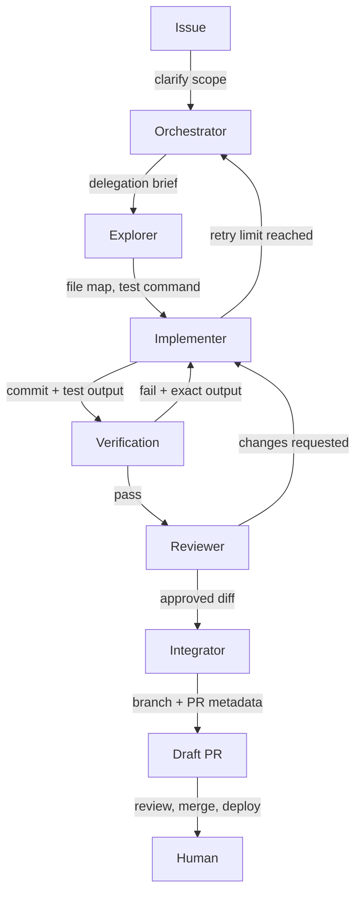

The issue is small enough to fit in one sentence: add `slugify(text)` to a utilities package, lowercase the input, trim it, collapse separator runs into single hyphens, and keep accented letters such as the é in Café. The design problem is not the function. It is the path the work travels when agents do it: who may write which file, what evidence each handoff carries, and where a human steps in.

The software factory that would run this pipeline is not part of this repository, so every role below is proposed rather than shipped. What you can verify here is the mechanics. Every command in this article was run on Node.js 20.18.2 and Git 2.43.0, and the outputs shown are the real ones from those runs.

## The five agent roles

None of these roles exists as implemented code today; every row is a proposal for how a factory could split one issue across agents with narrow permissions.

| Role         | Inputs                     | Outputs                                 | Write scope              | Cannot do                 |
| ------------ | -------------------------- | --------------------------------------- | ------------------------ | ------------------------- |
| Orchestrator | Issue, project conventions | Delegation brief, task lease            | Task record              | Edit code, merge, publish |
| Explorer     | Delegation brief           | File map, risks, test command           | Notes only               | Edit code                 |
| Implementer  | File map, brief            | Commit with tests, evidence             | Files named in the brief | Approve own work          |
| Reviewer     | Commit SHA, evidence       | Review note, approval or change request | Review note only         | Edit code                 |
| Integrator   | Approved diff, evidence    | Branch, draft pull request              | Branch, PR metadata      | Merge, publish, deploy    |

The narrow write scopes are the point. An Explorer that cannot edit code cannot quietly fix the bug it was only asked to describe, and a Reviewer that writes notes instead of patches keeps approval separated from authorship.

## The flow from issue to draft pull request

| Step | Owner        | Deliverable                | Verification evidence                                                  |
| ---- | ------------ | -------------------------- | ---------------------------------------------------------------------- |
| 1    | Orchestrator | Delegation brief           | Brief names scope, constraints, acceptance criteria, required evidence |
| 2    | Explorer     | File map and test command  | File paths exist, command runs                                         |
| 3    | Implementer  | Commit with tests          | Commit SHA, `git show --stat --oneline HEAD`, test output              |
| 4    | Reviewer     | Change request or approval | Independent test rerun                                                 |
| 5    | Integrator   | Draft pull request         | Branch name, PR body carrying the evidence                             |



Two edges in this diagram carry most of the pipeline's value. The fail edge returns the exact failing test and output to the Implementer, not a paraphrase, so the fix targets the real defect. The retry-limit edge escalates to the Orchestrator instead of looping forever on the same failure.

## Writing the delegation brief

The brief is the contract between the Orchestrator and everyone downstream. Handoff evidence, the artifacts one role returns so the next can check the work instead of trusting it, is named in the brief before any code exists:

| Field               | Content                                                                                                                    |
| ------------------- | -------------------------------------------------------------------------------------------------------------------------- |
| Scope               | Add `slugify(text)` in `src/slugify.mjs` and tests in `test/slugify.test.mjs`.                                             |
| Constraints         | No dependencies. Node 20. Keep accented letters. Do not edit files outside scope.                                          |
| Acceptance criteria | Lowercase, trim, replace runs of non-letter and non-number characters with one hyphen, strip leading and trailing hyphens. |
| Required evidence   | `node --test test/slugify.test.mjs`, `git show --stat --oneline HEAD`, and the commit SHA.                                 |

A brief this small is deliberate. It names the files, the runtime, the one behavior that is easy to get wrong, and the commands that prove the work. Anything else the Implementer discovers goes back through the Orchestrator as a scope question, not into a surprise edit.

Naming the evidence before any code exists does two things. It makes the handoff checkable mechanically, because the commands are re-runnable by any role, and it refuses the handoff that claims the work is done without showing anything. A failing test then points at a specific behavior instead of a vague report that something does not work.

## A handoff you can check

The Explorer returns three things: the file map (`src/slugify.mjs` plus `test/slugify.test.mjs`), the test command, and the Unicode constraint that accented letters must survive. The Implementer builds the first version:

```js
export function slugify(text) {
  return text
    .toLowerCase()
    .trim()
    .replace(/[^a-z0-9]+/g, "-")
    .replace(/^-+|-+$/g, "");
}
```

The tests cover the acceptance criteria, including the accented-letter case:

```js
import test from "node:test";
import assert from "node:assert/strict";

import { slugify } from "../src/slugify.mjs";

test("lowercases and joins words", () => {
  assert.equal(slugify("Hello World"), "hello-world");
});

test("collapses runs of separators", () => {
  assert.equal(slugify("  Hello   World  "), "hello-world");
});

test("keeps Unicode letters", () => {
  assert.equal(slugify("Café au lait"), "café-au-lait");
});

test("drops punctuation", () => {
  assert.equal(slugify("C++ & Rust"), "c-rust");
});
```

Each test targets one behavior from the criteria, and the two that catch real mistakes are the ones people skip: the accented-letter case and the punctuation run. Two behaviors go unasserted. The strip rule on the last line never fires in these tests, because no input starts or ends with a separator; `slugify("- hello -")` returns `hello` on this implementation. The empty input is also untested, because the brief promises nothing about it; `slugify("")` returns an empty string. A brief that cares about either case should say so, and the test file should grow.

Set up the demo repository and commit on a feature branch:

```bash
mkdir slugify-demo
cd slugify-demo
git init
git switch -c feat/slugify
```

Create the two files with the contents above, then commit and hand off:

```bash
git add .
git -c user.name="Demo" -c user.email="demo@example.com" commit -m "Add slugify and tests"
git show --stat --oneline HEAD
```

The `git show` output is the evidence half of the handoff. From the run for this article:

```text
5260227 Add slugify and tests
 src/slugify.mjs       |  7 +++++++
 test/slugify.test.mjs | 20 ++++++++++++++++++++
 2 files changed, 27 insertions(+)
```

The commit hash changes on every run; what stays stable is that the diff touches exactly the two files named in the brief.

## When verification fails

The Reviewer does not reuse the Implementer's terminal. A worktree, a second checkout of the same repository in its own folder, lets the Reviewer hold the `review/slugify` branch while the Implementer keeps `feat/slugify`:

```bash
git worktree add -b review/slugify ../slugify-review feat/slugify
cd ../slugify-review
node --test test/slugify.test.mjs
```

The first run fails, and the failure is the interesting part:

```text
# Subtest: keeps Unicode letters
not ok 3 - keeps Unicode letters
  ---
  error: |-
    Expected values to be strictly equal:
    + actual - expected

    + 'caf-au-lait'
    - 'café-au-lait'
  ...
# tests 4
# pass 3
# fail 1
```

`/[^a-z0-9]+/g` strips the é from Café because é is not in `a-z`. The Reviewer's note requests a Unicode-aware character class instead of offering a patch, because editing code is outside the Reviewer's write scope. The fix is one line in the Implementer's branch:

```js
.replace(/[^\p{Letter}\p{Number}]+/gu, "-")
```

[\p{Letter} and \p{Number}](https://developer.mozilla.org/en-US/docs/Web/JavaScript/Reference/Regular_expressions/Unicode_character_class_escape) match letters and numbers in any script, and the `u` flag is required for them to work at all. Apply the line in `src/slugify.mjs` in `slugify-demo`, commit, and return to the review branch:

```bash
cd ../slugify-demo
git add .
git -c user.name="Demo" -c user.email="demo@example.com" commit -m "Use a Unicode-aware character class"
cd ../slugify-review
```

The Reviewer pulls the fix and reruns:

```bash
git merge feat/slugify
node --test test/slugify.test.mjs
```

All four tests pass. The proposed retry rule for this pipeline is one automatic correction per failure type, then escalation to the Orchestrator. The limit counts failure types, not attempts: the Unicode failure above is one type and got one correction, and a rerun failing on the same test means the agent is guessing. A rerun failing on a different test is a new type with its own correction. Guessing belongs to a human decision: clarify the brief, split the task, or close the issue. For retries inside the model calls themselves, [schema-validated retries and fallback chains](/blog/building-reliable-llm-pipelines) cover the service-call side; this pipeline governs the work around those calls.

The Integrator's step is described rather than run, because this environment has no Git remote and no `gh` CLI. With a remote, the Integrator would push `feat/slugify` and open a draft pull request whose body carries the commit SHA, the test output, and the review note, so a human reads evidence instead of re-deriving it.

## Parallel work and one writer per file

Two agents editing the same working tree will overwrite each other's uncommitted changes. The rule that keeps parallel work safe is one writer per file, and [`git worktree`](https://git-scm.com/docs/git-worktree) is the mechanism that enforces it at the branch level. Each worktree checks out a different branch in its own folder, sharing the repository's object database, so the Reviewer's checkout cannot see the Implementer's uncommitted edits at all.

The demo commands above show the pattern: `feat/slugify` stays with the Implementer, `review/slugify` lives in `../slugify-review`, and neither touches the other's files. Work is safe to run in parallel when the file sets are disjoint; when two tasks must touch the same file, the Orchestrator sequences them instead of racing them.

## Handling failures and interruptions

Failed tests have a defined path, shown in the diagram: the exact failing test and output go back to the Implementer, one correction attempt runs, then the failure escalates. Review corrections follow the same loop with the review note as input.

Interrupted runs need a resume rule, proposed here as: the task record stores the last completed step and the commit SHA of the last evidence, and any resume starts by re-running the evidence commands rather than trusting the stored state. An interrupted run can also leave a worktree behind; `git worktree remove ../slugify-review` cleans it up, and the task record decides whether the branch is resumed or discarded. Duplicate task pickup needs a lease, a short-lived claim on a task that rejects a second pickup while the claim is alive. Both the resume and lease rules are marked proposed because they live in the Orchestrator, which is the part this repository does not implement.

## The human merge gate

A [draft pull request](https://docs.github.com/en/pull-requests/collaborating-with-pull-requests/proposing-changes-to-your-work-with-pull-requests/about-pull-requests) is a pull request GitHub marks as not ready for review; it cannot be merged until someone marks it ready for review. The Integrator may create one after approval, because a draft PR changes no production state. Merging, publishing, and deploying are human-only. [Branch protection](https://docs.github.com/en/repositories/configuring-branches-and-merges-in-your-repository/managing-protected-branches/about-protected-branches) can enforce this mechanically: requiring approving reviews before a merge, and required status checks, block a merge until a person approves it. No part of this pipeline auto-merges.

## Implemented versus proposed

| Part                                                                 | Status                                                           |
| -------------------------------------------------------------------- | ---------------------------------------------------------------- |
| Worktree isolation (`git worktree add`)                              | Implemented by Git 2.43.0; commands run for this article         |
| Test runner (`node:test`, `node --test`)                             | Implemented by Node.js 20.18.2; tests run for this article       |
| Draft pull requests                                                  | GitHub feature, documented but not run here (no remote, no `gh`) |
| Branch protection with required reviews                              | GitHub feature, documented but not run here                      |
| Agent write scopes, retry limits, task leases, human approval policy | Proposed, not implemented                                        |

The merge button is where the pipeline ends and a person begins. Everything upstream of that button exists to make the person's decision a reading task instead of an investigation.
